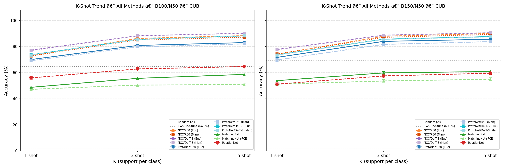

<div align="center">

# 🐦 Few-Shot Learning Paradigms for Bird Species Classification under Data Scarcity

**Can a model recognise a bird species it has seen only once?**

A controlled, reproducible comparison of metric-based few-shot learning methods —
Prototypical Networks, Matching Networks and Relation Networks — against supervised
and nearest-centroid baselines for classifying unseen bird species from 1, 3 or 5 images.


[](LICENSE)

*MSc Artificial Intelligence thesis ·
Pattern Recognition Lab (Informatik 5), Friedrich-Alexander-Universität Erlangen-Nürnberg (FAU) ·
01.08.2025–01.01.2026 · Advisor: Dr. Mathias Seuret*

[Scope](#-scope) · [Key findings](#-key-findings) · [Results](#-results) · [Dashboard](#-interactive-dashboard) · [Quick start](#-quick-start) · [Reproduce](#-reproducing-the-experiments) · [Structure](#-repository-structure)

</div>

---

## 📌 Overview

Supervised image classifiers need many labelled images per class. For rare, seasonal or
hard-to-photograph bird species that data often does not exist. **Few-Shot Learning (FSL)**
aims to classify *novel* species from only **K = 1, 3 or 5** labelled examples, after
learning on a disjoint set of *base* species.

The thesis builds a controlled evaluation framework that separates three kinds of models:
supervised upper-bound references, a non-episodic nearest-centroid baseline, and genuine
few-shot learners. All of them are compared under the same backbone and the same episodic
evaluation protocol.

## 🎯 Scope

### Core study (as in the submitted thesis)

| | |
|---|---|
| **Dataset** | [Birds 20 Species – Image Classification](https://www.kaggle.com/datasets/umairshahpirzada/birds-20-species-image-classification) (Pirzada, 2020): 3,408 images; 3,208 train / 100 val / 100 test |
| **Class split** | 15 base species for training, 5 novel species for evaluation (American Bittern, American Coot, American Flamingo, American Goldfinch, American Kestrel) |
| **Backbone** | ResNet-50 pretrained on ImageNet (2048-d embeddings) |
| **Few-shot methods** | Prototypical Networks, Matching Networks, Relation Networks |
| **Baselines** | Supervised Full-20 (upper bound), supervised Base-15, Nearest-Centroid Classifier (NCC; Chen et al., 2019) |
| **Protocol** | 5-way K-shot, K ∈ {1, 3, 5}; 600 evaluation episodes; mean accuracy, standard deviation and 95% Wilson confidence intervals; t-SNE of embeddings |
| **Training** | PyTorch, Adam, cosine-annealing LR, up to 25 epochs (supervised, early stopping) / 30 epochs (episodic), seed 42 |

### Extended experiments (in this repository, beyond the thesis)

The thesis lists larger datasets and Vision Transformers as future work. This repository
also contains those follow-up experiments:

- **Second split** on Birds-20: 10 base / 10 novel species (B10/N10)
- **CUB-200-2011** (Wah et al., 2011) with two splits: B100/N50 and B150/N50
- **DeiT-Small** (ViT) backbone for NCC and ProtoNet
- **Distance ablation:** Euclidean vs Manhattan for NCC and ProtoNet
- **MatchingNet + Full Context Embeddings (FCE)** and **ProtoNet + test-time augmentation**
- **Same-budget comparators:** K=5 fine-tuning and zero-shot transfer of the base-class model

<div align="center">

<br/><sub><b>Core study (Birds-20, 15 base / 5 novel, ResNet-50)</b>: method ranking, K-shot scaling, per-class accuracy, macro-F1 and the gain from episodic training over NCC.</sub>
</div>

---

## 🔑 Key Findings

### Core study (Birds-20, B15/N5, ResNet-50)

1. **Prototypical Networks are the strongest few-shot method**, reaching 94.1% at 1-shot,
   99.2% at 3-shot and 99.8% at 5-shot. That is on par with the fully supervised Full-20
   reference (99.0%), which sees every class with all of its training images.
2. **Accuracy rises with the number of shots for every method.** Most of the gain comes
   from K=1 → K=3; K=3 → K=5 adds less than 3 pp.
3. **Episodic training adds value over a strong frozen backbone.** ProtoNet beats the
   nearest-centroid baseline that uses the same distance (88.1% → 94.1% at 1-shot,
   +6.0 pp). The gap shrinks to +1.7 pp at 5-shot.
4. **Prototype-based methods clearly beat the attention and learned-metric methods.**
   Matching Networks (60.9–70.9%) and Relation Networks (72.7–78.8%) trail ProtoNet by
   21–33 pp and NCC by 15–30 pp.
5. **t-SNE shows compact per-species clusters** for the novel classes, so the base-class
   embedding transfers to unseen birds.

### Extended experiments

6. **On fine-grained CUB-200, the frozen NCC baseline beats ProtoNet at every shot count**
   (88.3% vs 83.0% at 5-shot, B100/N50). Representation quality matters more than the
   meta-learning algorithm on the harder benchmark.
7. **A stronger backbone gives the biggest single boost.** DeiT-S raises NCC 1-shot accuracy
   by up to 8.7 pp (Birds-20 B15/N5) and makes results almost insensitive to the distance metric.
8. **Euclidean beats Manhattan for ResNet-50 features** by up to ~14 pp (ProtoNet 1-shot,
   Birds-20). With DeiT-S the gap is below 0.5 pp.
9. **Base-class diversity matters.** Going from 15 to 10 base classes costs RelationNet
   13–16 pp, ProtoNet 4–6 pp and NCC only about 1 pp.
10. **FCE did not reliably help Matching Networks.** It improved only 1-shot on Birds-20
    B15/N5 and lowered accuracy in every other setting.

---

## 📊 Results

All few-shot numbers are **5-way K-shot mean accuracy (%) over 600 episodes**. The 95%
confidence intervals are narrow (typically ±0.2–0.8 pp) and are listed together with
macro-F1, precision, recall and AUC in
[`results/all_results_master.csv`](results/all_results_master.csv).

### Core study: Birds-20, 15 base / 5 novel, ResNet-50

| Method | Distance | 1-shot | 3-shot | 5-shot |
|---|---|---:|---:|---:|
| Nearest-Centroid Classifier | Euclidean | 88.05 | 97.58 | 98.14 |
| **Prototypical Networks** | Euclidean | **94.06** | **99.18** | **99.80** |
| Matching Networks | Cosine attention | 60.93 | 68.03 | 70.87 |
| Relation Networks | Learned | 72.71 | 78.19 | 78.75 |

| Supervised reference (fixed test set, not episodic) | Accuracy |
|---|---:|
| Full-20: all 20 species, full training data (upper bound) | 99.00 |
| Base-15: 15 base species only, evaluated on base classes | 100.00 |

> The supervised models are trained with all available images and evaluated on a fixed test
> set, so they are reference points rather than head-to-head competitors.

### Extended experiments

<details open>
<summary><b>Birds-20: both splits and both backbones</b></summary>

| Method | Backbone | B15/N5 1-shot | 3-shot | 5-shot | B10/N10 1-shot | 3-shot | 5-shot |
|---|---|---:|---:|---:|---:|---:|---:|
| NCC | ResNet-50 | 88.05 | 97.58 | 98.14 | 87.01 | 96.20 | 97.40 |
| NCC | DeiT-S | **96.72** | **99.89** | **99.99** | **95.35** | **98.11** | **98.61** |
| ProtoNet | ResNet-50 | 94.06 | 99.18 | 99.80 | 88.45 | 94.83 | 95.77 |
| ProtoNet | DeiT-S | 96.46 | 99.51 | 99.77 | 94.47 | 97.17 | 98.11 |
| ProtoNet + TTA×8 | ResNet-50 | – | – | 99.85 | – | – | 96.64 |
| MatchingNet | ResNet-50 | 60.93 | 68.03 | 70.87 | 59.11 | 63.35 | 66.74 |
| MatchingNet + FCE | ResNet-50 | 63.79 | 66.11 | 67.24 | 53.99 | 56.85 | 58.81 |
| RelationNet | ResNet-50 | 72.71 | 78.19 | 78.75 | 56.41 | 62.71 | 65.71 |

</details>

<details open>
<summary><b>CUB-200-2011: 200 fine-grained species</b></summary>

| Method | Backbone | B100/N50 1-shot | 3-shot | 5-shot | B150/N50 1-shot | 3-shot | 5-shot |
|---|---|---:|---:|---:|---:|---:|---:|
| NCC | ResNet-50 | 72.89 | 86.24 | 88.33 | 74.17 | 87.90 | 89.97 |
| NCC | DeiT-S | **77.23** | **88.27** | **90.17** | **77.77** | **88.72** | **90.57** |
| ProtoNet | ResNet-50 | 70.03 | 80.84 | 83.03 | 71.69 | 83.98 | 85.59 |
| ProtoNet | DeiT-S | 73.67 | 85.48 | 88.17 | 73.59 | 85.63 | 87.65 |
| MatchingNet | ResNet-50 | 48.74 | 55.62 | 58.64 | 53.86 | 59.80 | 60.86 |
| MatchingNet + FCE | ResNet-50 | 47.19 | 50.45 | 50.86 | 51.16 | 53.61 | 54.93 |
| RelationNet | ResNet-50 | 55.97 | 62.85 | 64.66 | 51.16 | 57.47 | 59.54 |

</details>

<details>
<summary><b>Supervised references and same-budget comparators (ResNet-50)</b></summary>

| Setting | Birds-20 | CUB-200 |
|---|---:|---:|
| Supervised, all classes | 99.00 (Full-20) | 79.46 (Full-200) |
| Supervised, base classes only | 100.00 (B15) · 100.00 (B10) | 79.40 (B100) · 78.04 (B150) |
| K=5 fine-tune on novel classes | 100.00 (B15/N5) · 92.00 (B10/N10) | 64.78 (B100/N50) · 69.01 (B150/N50) |
| Zero-shot transfer (base-class head on novel images) | 0.00 | 0.00 |

</details>

<details>
<summary><b>Distance-metric ablation (5-shot)</b></summary>

| Dataset / split | Method | Euclidean | Manhattan | Δ |
|---|---|---:|---:|---:|
| Birds-20 B15/N5 | ProtoNet R50 | 99.80 | 93.29 | +6.51 |
| Birds-20 B15/N5 | NCC R50 | 98.14 | 94.33 | +3.81 |
| Birds-20 B15/N5 | ProtoNet DeiT-S | 99.77 | 99.79 | −0.02 |
| Birds-20 B10/N10 | ProtoNet R50 | 95.77 | 90.14 | +5.63 |
| CUB B100/N50 | ProtoNet R50 | 83.03 | 82.03 | +1.00 |
| CUB B100/N50 | NCC DeiT-S | 90.17 | 90.09 | +0.08 |

</details>

### Figures

<div align="center">

<br/><sub><b>5-shot accuracy for every method</b> on Birds-20 and CUB-200 (extended experiments; Euclidean / default metric).</sub>
<br/><br/>

<br/><sub><b>CUB-200-2011</b>: accuracy vs K for every method and backbone, both splits.</sub>
</div>

More figures (confusion matrices, t-SNE embeddings, per-class heatmaps, failure cases)
are in [`results/birds20/analysis/`](results/birds20/analysis/) and
[`results/cub/analysis/`](results/cub/analysis/).

---

## 📈 Interactive Dashboard

The [`dashboard/`](dashboard/) folder contains a **Streamlit** app that reads the result
files in this repo directly. Nothing has to be exported by hand.

| Page | What it shows |
|---|---|
| 🏠 Home | Headline numbers, datasets and findings |
| 📊 Method Ranking | All methods at a chosen K and split |
| 📈 K-Shot Efficiency | Accuracy vs K and the marginal gain per extra shot |
| 🔬 Backbone Comparison | ResNet-50 vs DeiT-S |
| 📐 Distance Ablation | Euclidean vs Manhattan and how the gap collapses for ViT |
| 🐦 Per-Class Heatmap | Which novel species are hard, and for which method |
| 🌍 Cross-Benchmark | Does the method ranking transfer from Birds-20 to CUB? |
| 📚 Literature | CUB results next to published few-shot results |

```bash
pip install -r dashboard/requirements.txt
streamlit run dashboard/app.py          # opens http://localhost:8501
```

A dataset switch (Birds-20 / CUB-200 / All) sits behind the ⚙️ button at the top right.

---

## 🚀 Quick Start

```bash
git clone https://github.com/gmMustafa/Few-Shot-Learning-Paradigms-for-Bird-Species-Classification-under-Data-Scarcity.git
cd Few-Shot-Learning-Paradigms-for-Bird-Species-Classification-under-Data-Scarcity

python -m venv .venv
source .venv/bin/activate        # Windows: .venv\Scripts\activate
pip install -r requirements_hpc.txt
```

Every script runs on CPU (Windows-safe, `num_workers=0`). A GPU is strongly recommended
for full training. Every train and evaluate script accepts `--debug` for a fast
1-epoch / 5-episode smoke test.

### Data

| Dataset | Source | Expected location |
|---|---|---|
| **Birds-20** | [Birds 20 Species – Image Classification](https://www.kaggle.com/datasets/umairshahpirzada/birds-20-species-image-classification) (Kaggle; ImageFolder layout plus a `birds.csv` index) | `data/train`, `data/valid`, `data/test` |
| **CUB-200-2011** | [Caltech CUB-200-2011](https://www.vision.caltech.edu/datasets/cub_200_2011/) | raw: `data_cub-200-2011/CUB_200_2011/` → prepared: `data_cub_prepared/` |

Prepare CUB once (reorganises the official release into ImageFolder splits with fixed
base/novel class lists):

```bash
python data_prep/prepare_cub.py
python data_prep/validate_split.py --all   # check that base and novel classes are disjoint in every config
```

The datasets and trained checkpoints are not stored in the repo (see `.gitignore`).
The DeiT-S ImageNet weights are included in `pretrained_weights/` so that ViT runs work offline.

---

## 🔁 Reproducing the Experiments

Every experiment is driven by a YAML file in [`configs/`](configs/) (class splits,
seed = 42, hyper-parameters, output paths). Run scripts from their own directory.
Steps 1–3 with the default configs reproduce the core study.

```bash
# 1 — Supervised baselines (Full-20 upper bound, Base-15 backbone for NCC)
cd train_evaluate/baseline/resNet50_FS && python train.py && python evaluate.py && cd ../../..
cd train_evaluate/baseline/resNet50_bX
python train.py                                   # default: Birds-20 B15
python evaluate.py
python evaluate_novel_ncc.py --k-shot 1 --distance euclidean   # K ∈ {1,3,5}
cd ../../..

# 2 — Prototypical Networks
cd train_evaluate/proto_net
python train.py
python evaluate.py --k-shot 5 --distance euclidean
cd ../..

# 3 — Matching Networks and Relation Networks
cd train_evaluate/matchingnet && python train.py && python evaluate.py --k-shot 5 && cd ../..
cd train_evaluate/relationnet && python train.py && python evaluate.py --k-shot 5 && cd ../..

# ── Extended experiments ──────────────────────────────────────────────────────
# Fine-tune / zero-shot comparators, Manhattan distance
cd train_evaluate/baseline/resNet50_bX
python evaluate_novel_zeroshot.py
python finetune_novel_kshot.py
python evaluate_novel_ncc.py --k-shot 1 --distance manhattan
cd ../../..

# MatchingNet + FCE
cd train_evaluate/matchingnet && python train.py --config ../../configs/birds20/matchingnet_fce_configs.yaml && cd ../..

# DeiT-S backbone
cd train_evaluate/vit_backbone/baseline  && python train.py --config ../../../configs/birds20/vit_baseline_b15_config.yaml && cd ../../..
cd train_evaluate/vit_backbone/ncc       && python evaluate_novel_ncc.py --k-shot 5 && cd ../../..
cd train_evaluate/vit_backbone/proto_net && python train.py && python evaluate.py --k-shot 5 && cd ../../..

# Aggregate tables and figures
python compare_results.py          # Birds-20 → results/birds20/comparison/
python compare_results_cub.py      # CUB-200  → results/cub/comparison/
python plots/kshot_trend.py
python plots/per_class_heatmap.py
python plots/tsne_plot.py
```

To switch split or dataset, pass a different config, for example
`--config ../../configs/birds20/proto_configs_10b_10n.yaml` or
`--config ../../configs/cub/protonet_resnet50.yaml`.
Ready-made SLURM job scripts for the full pipeline are in
[`fau_hpc_jobs/`](fau_hpc_jobs/).

Each evaluation writes `summary.json`, `summary.txt`, per-episode accuracies, a
confusion matrix and (for the FSL methods) learning curves and t-SNE plots to
`results/<dataset>/<method>/<split>/<K>shot_<distance>/`.

---

## 🧪 Experimental Design

| Group | Method | Trained on | Role |
|---|---|---|---|
| Upper bound | Supervised Full-20 | all 20 species, full training data | ceiling, not a fair comparator |
| Feature extractor | Supervised Base-15 | 15 base species | provides embeddings for NCC |
| Non-episodic baseline | NCC | Base-15 backbone, frozen | isolates the effect of episodic training |
| Few-shot | Prototypical Networks | 5-way episodes on base classes | prototype = mean support embedding |
| Few-shot | Matching Networks | 5-way episodes on base classes | attention over individual support examples |
| Few-shot | Relation Networks | 5-way episodes on base classes | learned similarity function |
| *Extended* | K=5 fine-tune, zero-shot | base model + novel images | same data budget as 5-shot FSL |

**Evaluation protocol:** 5-way K-shot, K ∈ {1, 3, 5}. In each of 600 episodes a support
set (K images per class) and a query set are sampled from the novel classes. Supports
come from the novel *train* split and queries from the novel *test* split, so they never
overlap.

**Leakage guard:** [`data_prep/validate_split.py`](data_prep/validate_split.py) checks
every config for overlapping base and novel classes, duplicate entries and missing class
folders. [`utils/split_guard.py`](utils/split_guard.py) provides the same check as a
one-line call for use inside scripts.

---

## 🗂️ Repository Structure

```
├── configs/                 # YAML configs per dataset / method / split
│   ├── birds20/
│   └── cub/
├── dashboard/               # Streamlit results dashboard
├── data_prep/               # CUB preparation and split validation
├── models/                  # protonet.py, matchingnet.py (± FCE), relationnet.py, vit.py
├── train_evaluate/
│   ├── baseline/            # ResNet-50 supervised, NCC, fine-tune, zero-shot
│   ├── proto_net/
│   ├── matchingnet/
│   ├── relationnet/
│   └── vit_backbone/        # DeiT-S baseline, NCC, ProtoNet
├── utils/                   # dataset, episodic sampler, metrics, split guard
├── plots/                   # K-shot trends, per-class heatmaps, t-SNE
├── notebooks/               # EDA (Birds-20, CUB) and results analysis
├── results/                 # all summaries, CSVs and figures
├── fau_hpc_jobs/            # SLURM scripts for the GPU cluster
├── pretrained_weights/      # DeiT-S ImageNet weights
├── compare_results.py       # Birds-20 comparison table / LaTeX
├── compare_results_cub.py   # CUB comparison table / LaTeX
└── requirements_hpc.txt
```

---

## ⚠️ Limitations

- **Small dataset.** Birds-20 has only 20 species and 5 test images per species. Episode-level
  confidence intervals are tight, but they reflect variation across support sampling, not
  test-set size. The CUB-200 experiments were added as a larger, harder benchmark.
- **Gender imbalance.** About 80% of Birds-20 images show male birds, which usually have
  more distinctive plumage, and most validation and test images are male. Accuracy on
  female birds may be lower than reported.
- **Backbone.** The core study uses a single ResNet-50 backbone. DeiT-S results are in the
  extended experiments.
- **Method family.** Only metric-based few-shot methods are evaluated. Optimisation-based
  meta-learning such as MAML is not covered.
- **Simplified RelationNet.** An MLP relation module is used on pooled 2048-d features
  instead of the original convolutional module on spatial feature maps.

---

## 📚 References

- Snell, Swersky & Zemel (2017). *Prototypical Networks for Few-Shot Learning.* NeurIPS.
- Vinyals et al. (2016). *Matching Networks for One Shot Learning.* NeurIPS.
- Sung et al. (2018). *Learning to Compare: Relation Network for Few-Shot Learning.* CVPR.
- Chen et al. (2019). *A Closer Look at Few-Shot Classification.* ICLR.
- He et al. (2016). *Deep Residual Learning for Image Recognition.* CVPR.
- Deng et al. (2009). *ImageNet: A Large-Scale Hierarchical Image Database.* CVPR.
- Wilson (1927). *Probable Inference, the Law of Succession, and Statistical Inference.* JASA.
- van der Maaten & Hinton (2008). *Visualizing Data using t-SNE.* JMLR.
- Wang et al. (2020). *Generalizing from a Few Examples: A Survey on Few-Shot Learning.* ACM Computing Surveys.
- Pirzada (2020). *Birds 20 Species Image Classification* [Dataset]. Kaggle.
- Wah et al. (2011). *The Caltech-UCSD Birds-200-2011 Dataset.* Caltech Tech. Report CNS-TR-2011-001. *(extended experiments)*
- Touvron et al. (2021). *Training Data-Efficient Image Transformers & Distillation through Attention.* ICML. *(extended experiments)*

---

## 📝 Citation

```bibtex
@mastersthesis{mustafa2026fslbirds,
  title  = {Few-Shot Learning Paradigms for Bird Species Classification under Data Scarcity},
  author = {Mustafa, Ghulam},
  school = {Friedrich-Alexander-Universit{\"a}t Erlangen-N{\"u}rnberg},
  type   = {MSc Thesis in Artificial Intelligence},
  note   = {Pattern Recognition Lab (Informatik 5). Advisor: Dr. Mathias Seuret},
  year   = {2026},
  url    = {https://github.com/gmMustafa/Few-Shot-Learning-Paradigms-for-Bird-Species-Classification-under-Data-Scarcity}
}
```

---

## 📄 License

The code in this repository is released under the [MIT License](LICENSE).
The datasets (Birds-20 on Kaggle and CUB-200-2011) and the DeiT-S pretrained weights are
covered by their own licences and terms of use.
