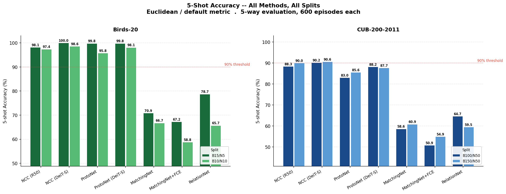
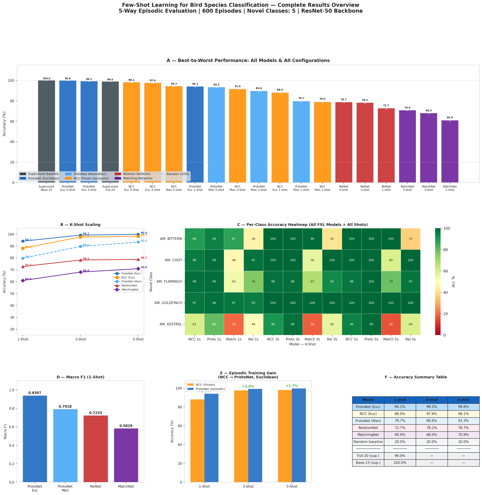

<div align="center">

# 🐦 Few-Shot Learning Paradigms for Bird Species Classification under Data Scarcity

**Can a model recognise a bird species it has seen only once?**

A controlled, reproducible comparison of metric-based few-shot learning methods —
Prototypical Networks, Matching Networks, Relation Networks — against strong
nearest-centroid and supervised baselines, on two bird benchmarks and two backbones.


[](LICENSE)

*MSc Artificial Intelligence thesis · Friedrich-Alexander-Universität Erlangen-Nürnberg (FAU) · 2026*

[Key findings](#-key-findings) · [Results](#-results) · [Dashboard](#-interactive-dashboard) · [Quick start](#-quick-start) · [Reproduce](#-reproducing-the-experiments) · [Structure](#-repository-structure)

</div>

---

## 📌 Overview

Supervised image classifiers need hundreds of labelled images per class. For rare or
newly-observed bird species that data simply does not exist. **Few-Shot Learning (FSL)**
aims to classify *novel* classes from only **K = 1, 3 or 5** labelled examples, after
learning on a disjoint set of *base* classes.

This repository contains the full experimental pipeline of the thesis:

- **4 FSL methods** — ProtoNet, MatchingNet, MatchingNet + FCE, RelationNet
- **Strong baselines** — Nearest-Centroid Classifier (NCC) on a frozen supervised backbone (Chen et al., 2019), K=5 fine-tuning, zero-shot transfer, and fully supervised upper bounds
- **2 backbones** — ResNet-50 (ImageNet) and DeiT-Small (ViT)
- **2 datasets × 2 base/novel splits each** — Birds-20 (B15/N5, B10/N10) and CUB-200-2011 (B100/N50, B150/N50)
- **Ablations** — Euclidean vs Manhattan distance, test-time augmentation, base-class diversity
- **Protocol** — 5-way K-shot, **600 episodes** per configuration, mean accuracy with 95% confidence intervals, macro-F1, AUC, per-class accuracy, confusion matrices and t-SNE plots

<div align="center">

<br/><sub><b>5-way 5-shot accuracy for every method on both datasets</b> (Euclidean / default metric, 600 episodes each).</sub>
</div>

---

## 🔑 Key Findings

1. **Representation quality matters more than the meta-learning algorithm.**
   A frozen backbone with a simple nearest-centroid classifier (NCC) is competitive with
   or better than every episodically trained method. On CUB-200 it *beats* ProtoNet at
   every shot count (e.g. 88.3% vs 83.0% at 5-shot, B100/N50).

2. **Episodic training helps only when base data is rich and the domain is easy.**
   ProtoNet improves over NCC on Birds-20 B15/N5 (+6.0 pp at 1-shot, +1.7 pp at 5-shot),
   but the gain shrinks or reverses with fewer base classes (B10/N10) and reverses on fine-grained CUB.

3. **Learned comparison modules underperform.** MatchingNet (cosine attention) and
   RelationNet (learned MLP metric) trail the prototype-based methods by roughly 20–35 pp.
   Full Context Embeddings (FCE) helped MatchingNet only at 1-shot on Birds-20 B15/N5
   and **hurt it everywhere else**.

4. **A stronger backbone gives the biggest single boost.** Swapping ResNet-50 for DeiT-S
   raises 1-shot accuracy by up to +8.7 pp (Birds-20 B15/N5 NCC) and makes the
   method largely **insensitive to the distance metric**.

5. **Euclidean > Manhattan for CNN features.** With ResNet-50, L2 beats L1 by up to
   ~14 pp (ProtoNet 1-shot, Birds-20). With DeiT-S the gap collapses to < 0.5 pp.

6. **Base-class diversity matters.** Moving from 15 to 10 base classes on Birds-20 costs
   RelationNet ~13–16 pp, ProtoNet ~4–6 pp, and NCC only ~1 pp.

7. **Diminishing returns beyond 3 shots.** Most of the gain comes from K=1 → K=3;
   K=3 → K=5 adds only about 0.5–2 pp for the strong methods.

---

## 📊 Results

All FSL numbers are **5-way K-shot mean accuracy (%) over 600 episodes**. 95% CIs are
narrow (typically ±0.2–0.8 pp) and are listed in
[`results/all_results_master.csv`](results/all_results_master.csv).
Distance is Euclidean unless the method fixes its own metric.

### Birds-20 (20 species, ~3.1k training images)

| Method | Backbone | B15/N5 1-shot | 3-shot | 5-shot | B10/N10 1-shot | 3-shot | 5-shot |
|---|---|---:|---:|---:|---:|---:|---:|
| NCC (frozen) | ResNet-50 | 88.05 | 97.58 | 98.14 | 87.01 | 96.20 | 97.40 |
| NCC (frozen) | DeiT-S | **96.72** | **99.89** | **99.99** | **95.35** | **98.11** | **98.61** |
| ProtoNet | ResNet-50 | 94.06 | 99.18 | 99.80 | 88.45 | 94.83 | 95.77 |
| ProtoNet | DeiT-S | 96.46 | 99.51 | 99.77 | 94.47 | 97.17 | 98.11 |
| ProtoNet + TTA×8 | ResNet-50 | – | – | 99.85 | – | – | 96.64 |
| MatchingNet (cosine) | ResNet-50 | 60.93 | 68.03 | 70.87 | 59.11 | 63.35 | 66.74 |
| MatchingNet + FCE | ResNet-50 | 63.79 | 66.11 | 67.24 | 53.99 | 56.85 | 58.81 |
| RelationNet (learned) | ResNet-50 | 72.71 | 78.19 | 78.75 | 56.41 | 62.71 | 65.71 |

### CUB-200-2011 (200 fine-grained species, 11.8k images)

| Method | Backbone | B100/N50 1-shot | 3-shot | 5-shot | B150/N50 1-shot | 3-shot | 5-shot |
|---|---|---:|---:|---:|---:|---:|---:|
| NCC (frozen) | ResNet-50 | 72.89 | 86.24 | 88.33 | 74.17 | 87.90 | 89.97 |
| NCC (frozen) | DeiT-S | **77.23** | **88.27** | **90.17** | **77.77** | **88.72** | **90.57** |
| ProtoNet | ResNet-50 | 70.03 | 80.84 | 83.03 | 71.69 | 83.98 | 85.59 |
| ProtoNet | DeiT-S | 73.67 | 85.48 | 88.17 | 73.59 | 85.63 | 87.65 |
| MatchingNet (cosine) | ResNet-50 | 48.74 | 55.62 | 58.64 | 53.86 | 59.80 | 60.86 |
| MatchingNet + FCE | ResNet-50 | 47.19 | 50.45 | 50.86 | 51.16 | 53.61 | 54.93 |
| RelationNet (learned) | ResNet-50 | 55.97 | 62.85 | 64.66 | 51.16 | 57.47 | 59.54 |

### Reference baselines (ResNet-50)

| Setting | Birds-20 | CUB-200 |
|---|---:|---:|
| Supervised, all classes (upper bound) | 99.00 (Full-20) | 79.46 (Full-200) |
| Supervised, base classes only | 100.00 (B15) · 100.00 (B10) | 79.40 (B100) · 78.04 (B150) |
| K=5 fine-tune on novel classes | 100.00 (B15/N5) · 92.00 (B10/N10) | 64.78 (B100/N50) · 69.01 (B150/N50) |
| Zero-shot transfer (base head on novel images) | 0.00 | 0.00 |

> Supervised rows are evaluated on a fixed test set rather than in 5-way episodes, so they
> are reference points, not head-to-head competitors to the FSL methods.

<details>
<summary><b>Distance-metric ablation (5-shot)</b></summary>

| Dataset / split | Method | Euclidean | Manhattan | Δ |
|---|---|---:|---:|---:|
| Birds-20 B15/N5 | ProtoNet R50 | 99.80 | 93.29 | +6.51 |
| Birds-20 B15/N5 | NCC R50 | 98.14 | 94.33 | +3.81 |
| Birds-20 B15/N5 | ProtoNet DeiT-S | 99.77 | 99.79 | −0.02 |
| Birds-20 B10/N10 | ProtoNet R50 | 95.77 | 90.14 | +5.63 |
| CUB B100/N50 | ProtoNet R50 | 83.03 | 82.03 | +1.00 |
| CUB B100/N50 | NCC DeiT-S | 90.17 | 90.09 | +0.08 |

</details>

### Figures

<div align="center">

<br/><sub><b>Birds-20 B15/N5 overview</b>: ranking, K-shot scaling, per-class heatmap, macro-F1 and the gain from episodic training.</sub>
<br/><br/>

<br/><sub><b>CUB-200-2011</b>: accuracy vs K for every method and backbone, both splits.</sub>
</div>

More than 100 further figures (confusion matrices, t-SNE embeddings, per-class
heatmaps, failure cases, one figure per research question) live in
[`results/birds20/analysis/`](results/birds20/analysis/) and
[`results/cub/analysis/`](results/cub/analysis/). Captions for each are in
[`results/birds20/analysis/README.md`](results/birds20/analysis/README.md).

---

## 📈 Interactive Dashboard

The [`dashboard/`](dashboard/) folder contains a **Streamlit** app that reads the result
files in this repo directly. Nothing has to be exported by hand.

| Page | What it shows |
|---|---|
| 🏠 Home | Headline numbers, datasets and core findings |
| 📊 Method Ranking | All methods at a chosen K and split |
| 📈 K-Shot Efficiency | Accuracy vs K and the marginal gain per extra shot |
| 🔬 Backbone Comparison | ResNet-50 vs DeiT-S |
| 📐 Distance Ablation | Euclidean vs Manhattan and how the gap collapses for ViT |
| 🐦 Per-Class Heatmap | Which novel species are hard, and for which method |
| 🌍 Cross-Benchmark | Does the method ranking transfer from Birds-20 to CUB? |
| 📚 Literature | CUB results next to published few-shot results |

```bash
pip install -r dashboard/requirements.txt
streamlit run dashboard/app.py          # opens http://localhost:8501
```

A dataset switch (Birds-20 / CUB-200 / All) sits behind the ⚙️ button at the top right.

---

## 🚀 Quick Start

```bash
git clone https://github.com/gmMustafa/Few-Shot-Learning-Paradigms-for-Bird-Species-Classification-under-Data-Scarcity.git
cd Few-Shot-Learning-Paradigms-for-Bird-Species-Classification-under-Data-Scarcity

python -m venv .venv
source .venv/bin/activate        # Windows: .venv\Scripts\activate
pip install -r requirements_hpc.txt
```

Every script runs on CPU (Windows-safe, `num_workers=0`). A GPU is strongly recommended
for full training. Every train and evaluate script accepts `--debug` for a fast
1-epoch / 5-episode smoke test.

### Data

| Dataset | Source | Expected location |
|---|---|---|
| **Birds-20** | [Birds 20 Species – Image Classification](https://www.kaggle.com/datasets/umairshahpirzada/birds-20-species-image-classification) (Kaggle; ImageFolder layout plus a `birds.csv` index) | `data/train`, `data/valid`, `data/test` |
| **CUB-200-2011** | [Caltech CUB-200-2011](https://www.vision.caltech.edu/datasets/cub_200_2011/) | raw: `data_cub-200-2011/CUB_200_2011/` → prepared: `data_cub_prepared/` |

Prepare CUB once (reorganises the official release into ImageFolder splits with fixed
base/novel class lists):

```bash
python data_prep/prepare_cub.py
python data_prep/validate_split.py --all   # check that base and novel classes are disjoint in every config
```

The datasets and trained checkpoints are not stored in the repo (see `.gitignore`).
The DeiT-S ImageNet weights are included in `pretrained_weights/` so that ViT runs work offline.

---

## 🔁 Reproducing the Experiments

Every experiment is driven by a YAML file in [`configs/`](configs/) (class splits,
seed = 42, hyper-parameters, output paths). Run scripts from their own directory.

```bash
# 1 — Supervised baseline on base classes (backbone for NCC / fine-tune / zero-shot)
cd train_evaluate/baseline/resNet50_bX
python train.py                                   # default: Birds-20 B15
python evaluate.py
python evaluate_novel_zeroshot.py
python finetune_novel_kshot.py
python evaluate_novel_ncc.py --k-shot 1 --distance euclidean   # K ∈ {1,3,5}, L1/L2
cd ../../..

# 2 — Prototypical Networks
cd train_evaluate/proto_net
python train.py
python evaluate.py --k-shot 5 --distance euclidean
cd ../..

# 3 — Matching Networks (vanilla / FCE) and Relation Networks
cd train_evaluate/matchingnet && python train.py && python evaluate.py --k-shot 5 && cd ../..
cd train_evaluate/matchingnet && python train.py --config ../../configs/birds20/matchingnet_fce_configs.yaml && cd ../..
cd train_evaluate/relationnet && python train.py && python evaluate.py --k-shot 5 && cd ../..

# 4 — DeiT-S backbone
cd train_evaluate/vit_backbone/baseline  && python train.py --config ../../../configs/birds20/vit_baseline_b15_config.yaml && cd ../../..
cd train_evaluate/vit_backbone/ncc       && python evaluate_novel_ncc.py --k-shot 5 && cd ../../..
cd train_evaluate/vit_backbone/proto_net && python train.py && python evaluate.py --k-shot 5 && cd ../../..

# 5 — Aggregate tables and figures
python compare_results.py          # Birds-20 → results/birds20/comparison/
python compare_results_cub.py      # CUB-200  → results/cub/comparison/
python plots/kshot_trend.py
python plots/per_class_heatmap.py
python plots/tsne_plot.py
```

To switch split or dataset, pass a different config, for example
`--config ../../configs/birds20/proto_configs_10b_10n.yaml` or
`--config ../../configs/cub/protonet_resnet50.yaml`.
Ready-made SLURM job scripts for the full pipeline are in
[`fau_hpc_jobs/`](fau_hpc_jobs/).

Each evaluation writes `summary.json`, `summary.txt`, per-episode accuracies, a
confusion matrix and (for the FSL methods) learning curves and t-SNE plots to
`results/<dataset>/<method>/<split>/<K>shot_<distance>/`.

---

## 🧪 Experimental Design

| Group | Method | Trained on | Role |
|---|---|---|---|
| Upper bound | Supervised Full / Base | all labelled images | ceiling, not a fair comparator |
| Naïve transfer | Zero-shot | base classes only | shows a base-class head cannot name novel species (0%) |
| Supervised comparator | K=5 fine-tune | base + 5 novel images per class | same data budget as 5-shot FSL |
| Representation baseline | NCC (L1 / L2) | standard CE on base classes, then frozen | isolates the effect of episodic training |
| FSL | ProtoNet (L1 / L2) | 5-way episodes on base classes | prototype = mean support embedding |
| FSL | MatchingNet (± FCE) | 5-way episodes | cosine attention over individual supports |
| FSL | RelationNet | 5-way episodes | learned MLP similarity, MSE objective |

**Evaluation protocol:** 5-way K-shot, K ∈ {1, 3, 5}. Support images are sampled from
the novel *train* split and queries from the novel *test* split, so supports and queries
never overlap. Each configuration is evaluated on 600 random episodes with a fixed seed.

**Leakage guard:** [`data_prep/validate_split.py`](data_prep/validate_split.py) checks
every config for overlapping base and novel classes, duplicate entries and missing class
folders. [`utils/split_guard.py`](utils/split_guard.py) provides the same check as a
one-line call for use inside scripts.

---

## 🗂️ Repository Structure

```
├── configs/                 # YAML configs per dataset / method / split
│   ├── birds20/
│   └── cub/
├── dashboard/               # Streamlit results dashboard
├── data_prep/               # CUB preparation and split validation
├── models/                  # protonet.py, matchingnet.py (± FCE), relationnet.py, vit.py
├── train_evaluate/
│   ├── baseline/            # ResNet-50 supervised, zero-shot, fine-tune, NCC
│   ├── proto_net/
│   ├── matchingnet/
│   ├── relationnet/
│   └── vit_backbone/        # DeiT-S baseline, NCC, ProtoNet
├── utils/                   # dataset, episodic sampler, metrics, split guard
├── plots/                   # K-shot trends, per-class heatmaps, t-SNE
├── notebooks/               # EDA (Birds-20, CUB) and results analysis
├── results/                 # all summaries, CSVs and figures (≈140 experiments)
├── fau_hpc_jobs/            # SLURM scripts for the GPU cluster
├── pretrained_weights/      # DeiT-S ImageNet weights
├── compare_results.py       # Birds-20 comparison table / LaTeX
├── compare_results_cub.py   # CUB comparison table / LaTeX
└── requirements_hpc.txt
```

---

## ⚠️ Limitations

- **Small Birds-20 test set.** There are only 5 test images per novel class. Episode-level
  CIs are tight, but they measure variation across support sampling, not test-set size.
  This is why the CUB-200 experiments were added as a harder, larger benchmark.
- **Simplified RelationNet.** An MLP relation module is used on pooled 2048-d features
  instead of the original convolutional module on spatial feature maps.
- **Single run per configuration.** Variance comes from 600 episodes with one training seed (42).

---

## 📚 References

- Snell, Swersky & Zemel (2017). *Prototypical Networks for Few-Shot Learning.* NeurIPS.
- Vinyals et al. (2016). *Matching Networks for One Shot Learning.* NeurIPS.
- Sung et al. (2018). *Learning to Compare: Relation Network for Few-Shot Learning.* CVPR.
- Chen et al. (2019). *A Closer Look at Few-Shot Classification.* ICLR.
- He et al. (2016). *Deep Residual Learning for Image Recognition.* CVPR.
- Touvron et al. (2021). *Training Data-Efficient Image Transformers & Distillation through Attention.* ICML.
- Wah et al. (2011). *The Caltech-UCSD Birds-200-2011 Dataset.* Caltech Tech. Report CNS-TR-2011-001.
- Wang et al. (2020). *Generalizing from a Few Examples: A Survey on Few-Shot Learning.* ACM Computing Surveys.

---

## 📝 Citation

```bibtex
@mastersthesis{mustafa2026fslbirds,
  title  = {Few-Shot Learning Paradigms for Bird Species Classification under Data Scarcity},
  author = {Mustafa, Ghulam},
  school = {Friedrich-Alexander-Universit{\"a}t Erlangen-N{\"u}rnberg},
  year   = {2026},
  type   = {MSc Thesis in Artificial Intelligence}
}
```

---

## 📄 License

The code in this repository is released under the [MIT License](LICENSE).
The datasets (Birds-20 on Kaggle and CUB-200-2011) and the DeiT-S pretrained weights are
covered by their own licences and terms of use.
